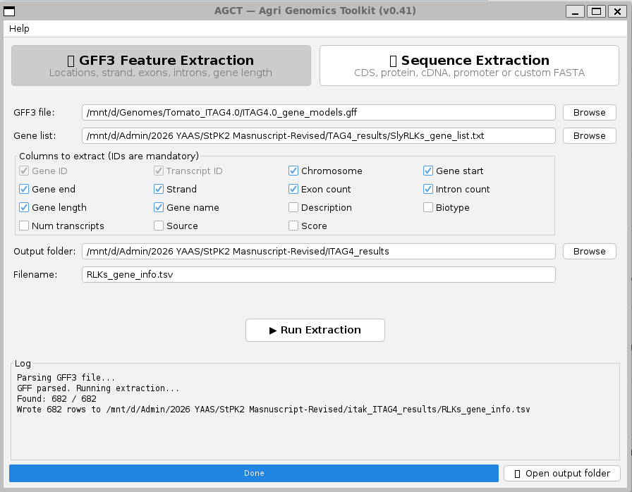
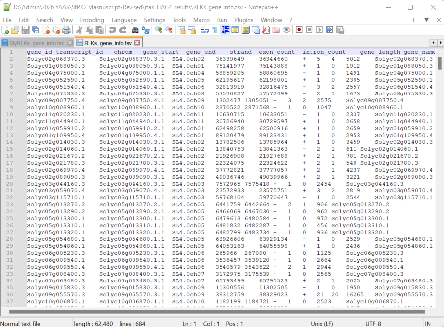
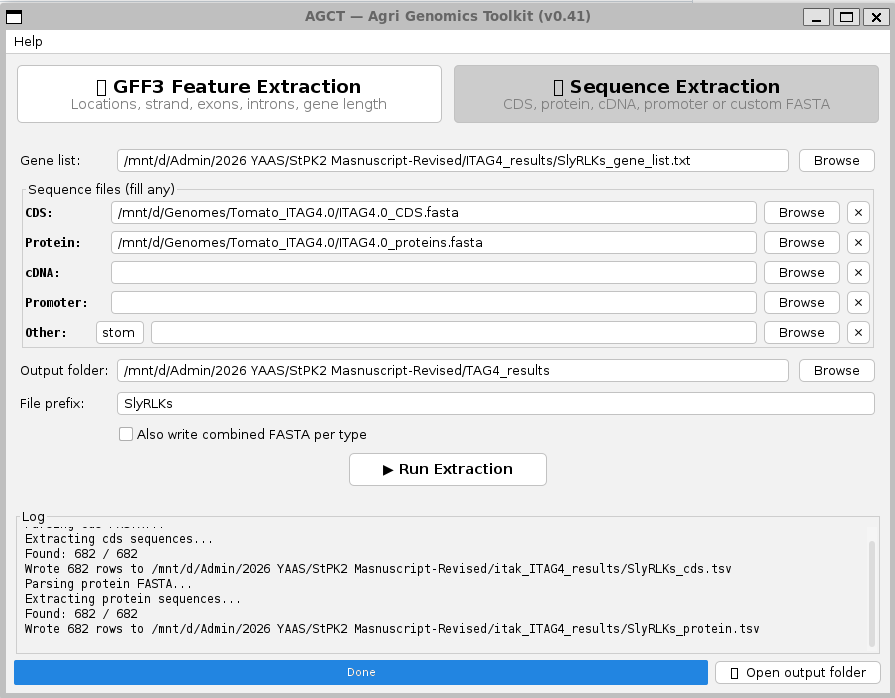
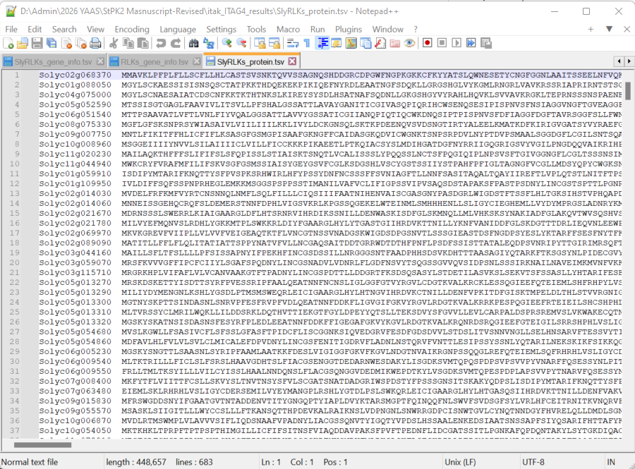
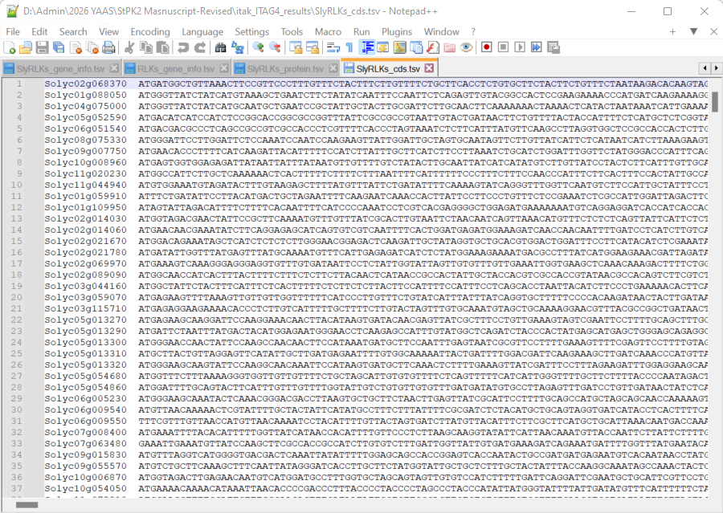

# AGCT — Agri Genomics Toolkit (v0.41)

AGCT is a user-friendly desktop application designed for extracting genomic feature annotations and sequence records from GFF3 and FASTA files. It provides a graphical interface (GUI) so researchers and students can process their data without needing to use the command line.

## ✨ Features

* **GFF3 Feature Extraction:** Extract gene locations, strand, exon/intron counts, gene length, and more. Just upload your GFF3 file and your gene list!


* **Sequence Extraction:** Extract CDS, Protein, cDNA, or Promoter sequences for your genes of interest.



* **Drag & Drop Support:** Quickly load files by dragging them directly into the app.
* **Combine Results:** Merge your GFF annotations and sequence data into a single, comprehensive table.

## 🚀 How to Run

**Requirement:** You must have **Java 17** (or higher) installed on your computer.

1. Go to the **[Releases](../../releases)** tab on the right side of this page.
2. Download the latest `agct.jar` file.
3. Double-click the file to run the application. 
   *(If double-clicking doesn't work, open your terminal/command prompt and run: `java -jar agct.jar`)*

## 🧬 For Developers

If you want to compile the source code yourself:
```bash
mvn clean package
java -jar target/agct.jar# AGCT-Toolkit

## 👨‍🔬 Author & Contact

Dr. Rana Muhammad Atif
Plant Genomics Lab,
Center for Advanced Studies in Agriculture & Food Security,
University of Agriculture Faisalabad. Pakistan

📧 Email: dratif@uaf.edu.pk

💼 LinkedIn: Rana Muhammad Atif
🐙 GitHub: @agrarian1226
🎓 Google Scholar: Profile

## 📄 License
This project is licensed under the MIT License - see the LICENSE file for details.
